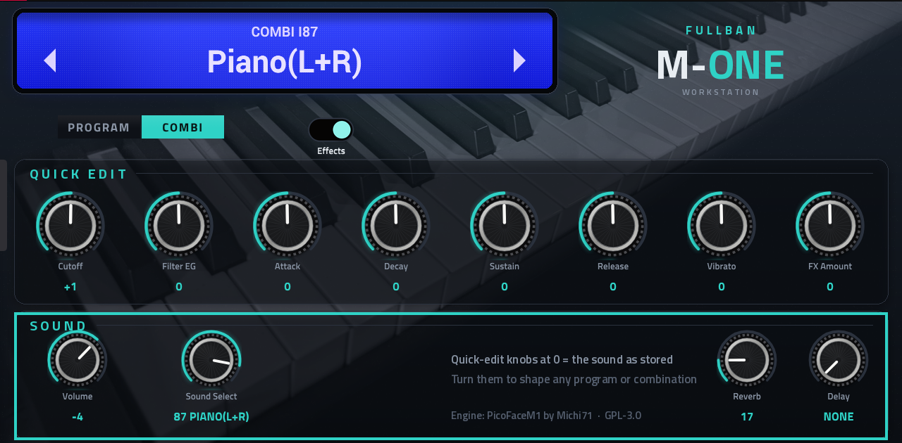
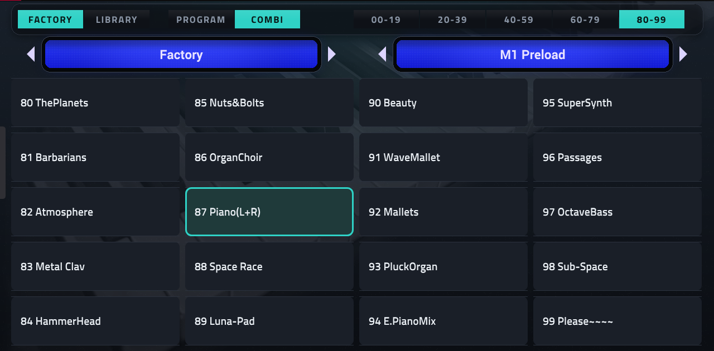
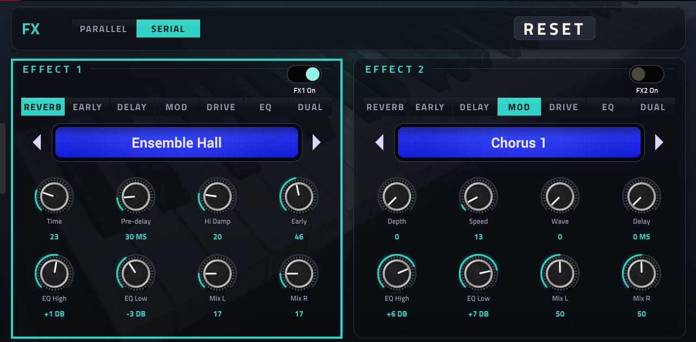

# Fullban M-One

A Korg M1-style ROM workstation for MPC OS standalone devices (Akai Force, MPC One/Live/X/Key on Gen1; MPC XL, Live III on
Gen2): 100 programs, 100 combinations, the M1's 33 effects, quick-edit knobs, a Library of SysEx banks.

| Browse | FX |
|---|---|
|  |  |

**You need your own Korg M1 ROM set.** Nothing from the ROMs is in this repository or in the released plugin: M-One reads
your files from its `Content/ROMs` folder when it starts. Without them it is silent and its display says `NO M1 ROMS`.

| File | What |
|---|---|
| `IC36.bin` .. `IC43.bin` | PCM, 8 x 512 KB |
| `IC30.bin` | coefficient ROM, 64 KB (`IC20.bin` / `IC26.bin` also work) |
| two 64 KB files, any names | the two halves of the original M1 OS, Rev 19 (the Plus+1 OS is not supported) |
| one `.syx` | an M1 ALL DATA dump: the factory programs, combinations and drum kits |

The catalog's desktop installer checks each file before copying it ("Your ROMs and files").

## Install (MPC OS 3.10.1 or later)

1. **Preferences > Enhancements (Beta)**: turn on **Enable Enhancements** and **External Plugin Support**.
2. Download `M-One-1.3.0.zip` from [Releases](https://github.com/fullbann/mpc-vst-m-one/releases) and unzip it.
3. Copy the folder `Fullban - VST - M-One` into `VST2 Plugins` at the top of a drive: the internal drive, an SD card or a
   USB drive (make `VST2 Plugins` if it isn't there). One folder works on Gen1 (Force, Live, One, X, Key) and Gen2 (XL, Live III).
4. Put your ROM files (table above) in `Fullban - VST - M-One/Content/ROMs`.
5. Restart MPC (a USB drive can just be re-plugged). M-One is under **External Plugins** and opens on **Fullban / Preview**.

**Q-Links.** Force (8 Q-Links): on Play, tap **Quick Edit** or **Sound** to choose what the knobs control; on FX tap
**Effect 1** or **Effect 2**; Browse has one Preset knob. Units with 16 Q-Links get everything at once.

## Sounds

- **Factory**: from your own ALL DATA dump.
- **Library**: `.m1b` banks in `Content/Banks/<author>/`. The release includes **Fullban / Preview**, ten original
  programs written for M-One (DualPnoHse, HseOrgan, SpaceStab, WarmPad, BellEP, SubBass, SawLead, GlassKeys, PluckArp,
  AiryChoir). Convert your own SysEx banks with a `syx2m1b`-style tool (format: `M1B1`, flags, 3 reserved bytes,
  100 x 143 program bytes, then optionally 100 x 124 combination bytes and 4 x 210 drum-kit bytes).

## Build

    pip install ziglang==0.17.1
    git clone https://github.com/open-mpc/mpc-vst-plugins mv
    python3 -I mv/tools/gen_vst.py vst/vst.json --params-h      # (the skin build also needs Chrome)
    tools/build_zig.sh mv all        # vst/build/m-one.so (armv7), vst/build/aarch64/m-one.so

Test: `MPC_PLUGIN_FOLDER=<folder with plugin.json and Content/ROMs> tools/test_arm.sh mv` (open-mpc host test under qemu).

## Credits and licence

- Engine: **PicoFaceM1** by Michi71 (GPL-3.0), vendored in `src/m1`. ROM reader: a C++ port of Michi71's
  `tools/m1_extract` (MIT, kept here as the reference; it gives byte-identical tables).
- MPC wrapper: open-mpc/mpc-vst-plugins.
- Plugin, skin and Preview bank: Fullban (Christopher Fuller). Skin photos are the author's own.
- M-One is GPL-3.0-or-later. It is not affiliated with or endorsed by Korg; "M1" refers to the hardware whose ROMs you supply.
